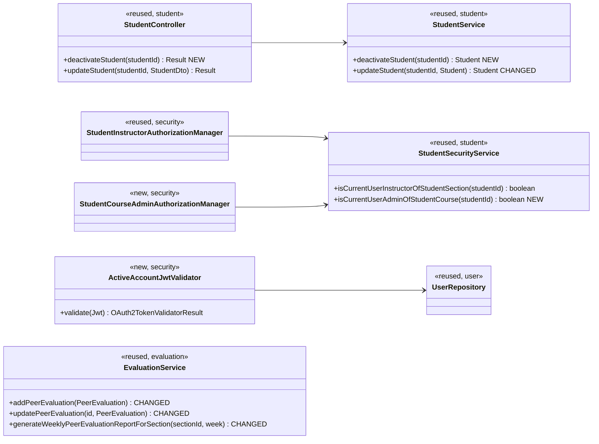

# Students (STU) Design

> Realizes: UC-STU-deactivate-student
> Depends on: FR-SEC-active-account, BR-student-lifecycle, BR-section-scoped-access, BR-role-based-access, BR-submission-owed, BR-evaluation-submission-window, BR-team-assignment-required
> Consequences in another area: UC-EVA-submit-evaluation, UC-EVA-section-evaluation-report (see *Consequences in the evaluation slice*)
> See: [use cases](../requirements/use-cases.md#student), [SRS security requirements](../requirements/software-requirements-specification.md#security-and-authorization-requirements), [architectural-design.md](architectural-design.md#authentication) (Authentication › Account status, Authorization, foundation component view)
> Designed against `main` at `59f0267` (2026-11-06).

## Overview

This area covers the student account in the `student` slice of the foundation (REST API container). This design adds one action, deactivating a student, as its own endpoint with its own confirmation. Before this design the only way to deactivate a student was the Status switch in the generic *Edit a student* dialog. That switch showed no consequences and asked for no confirmation. Its route refused a course admin who is not assigned to the student's course section. It deactivated a student whenever an instructor's update left `enabled` out, because `StudentDto.enabled` is a primitive `boolean`. And a deactivated student kept working until her token expired, because only login checked the flag.

Deactivation has two consequences outside this slice, both decided by BR-student-lifecycle:
- teammates stop evaluating her;
- the course section's peer evaluation report keeps her past record without showing her empty weeks as failing grades.

Both are designed here (see *Consequences in the evaluation slice*), because they exist only because of this use case. UC-STU-reactivate-student is out of scope. Its interim path, the edit-student switch limited to enabling, is recorded in that use case's Associated Information.

## Components & classes



- **Backend, new:**
  - `StudentController.deactivateStudent`
  - `StudentService.deactivateStudent`:
    - loads the student through a caller-scoped finder, `StudentRepository.findByIdInCallerScope(studentId, userId)`. This is a `@Query` matching the student only when the caller is one of her course section's instructors or her course's admin, with `userId` from `UserUtils.getUserId()`. Not finding her raises `ObjectNotFoundException` (`404`), which happens only when she is deleted between the route rule and the query;
    - sets `enabled` to false and saves, and returns whether anything changed, so the controller can tell step 6 from 6a.
  - `StudentSecurityService.isCurrentUserAdminOfStudentCourse`: student → `section` → `course` → `courseAdmin`, compared with `UserUtils.getUserId()`. It returns `false` for an unknown id and never throws. `Student.section`, `Section.course` and `Course.courseAdmin` are all `optional = false`, so only the student lookup needs a null check.
  - `security/authorizationmanagers/StudentCourseAdminAuthorizationManager`: reads `studentId` with `PathVariables.readId` and delegates to that method.
  - `security/ActiveAccountJwtValidator`: see [Authentication › Account status](architectural-design.md#authentication). It is registered on `SecurityConfiguration.jwtDecoder()` through `DelegatingOAuth2TokenValidator` together with `JwtValidators.createDefault()`.
- **Backend, changed:**
  - `StudentService.updateStudent` may set `enabled` from false to true for a caller with `ROLE_instructor` (the interim reactivation path), and never sets it from true to false.
  - `EvaluationService`: see *Consequences in the evaluation slice*.
- **Backend, reused:** `StudentInstructorAuthorizationManager`, `UserRepository`, `ExceptionHandlerAdvice` (its existing `InvalidBearerTokenException` → `401` and `PeerEvaluationIllegalArgumentException` → `400` mappings).
- **Frontend:**
  - `apis/student` gains `deactivateStudent(studentId)`.
  - `pages/students/EditStudentForm.vue`. This dialog is the student's details view: it is how UC-STU-view-student is realized today (it loads `findStudentById`), so step 2 happens here.
    - When the student is enabled, the Status switch is disabled and a **Deactivate** button is shown. Clicking it opens `ElMessageBox.confirm` with `type: 'warning'`, the title "Deactivate *First Last*?", and the buttons **Deactivate** and **Cancel** (step 4). The confirm button is disabled while the request is in flight. Deactivation acts only on the status: unsaved edits to other fields are discarded when the dialog closes, as on Cancel today. The text states each consequence in UC-STU-deactivate-student's Associated Information:
      - she can no longer log in, and a session she has open ends;
      - she can no longer submit weekly activity reports or peer evaluations;
      - her teammates no longer evaluate her;
      - her account, team assignment, and submitted work are kept, and she can be reactivated later;
      - this is not deletion.
    - When the student is deactivated, no Deactivate button is shown (3a) and the switch stays usable for the interim reactivation.
    - On success it shows `ElMessage.success`, using the name from the response: "*First Last* has been deactivated." (step 6), or "*First Last* is already deactivated." when the response says nothing changed (6a1). It then closes the dialog, and `Students.vue` reloads the table, as it already does.
  - `pages/evaluations/SubmitTeamsEvaluations.vue` lists only teammates whose `enabled` is true. `GET /students/teams/{teamId}` already returns `StudentDto`, which carries `enabled`.

## Sequence

### UC-STU-deactivate-student: deactivate a student

```mermaid
sequenceDiagram
    actor A as Course admin or instructor
    participant SPA as SPA (Students.vue, EditStudentForm)
    participant RR as Route rule (SecurityConfiguration)
    participant SC as StudentController
    participant SS as StudentService
    A->>SPA: Open a student from Students (steps 1 and 2, UC-STU-view-student)
    SPA-->>A: Details and status; Deactivate only if enabled (3a: none if deactivated)
    A->>SPA: Deactivate (step 3)
    SPA-->>A: Consequences, warning, Deactivate or Cancel (step 4)
    alt Cancel (5a)
        SPA-->>A: Dialog stays open, nothing sent, account unchanged (5a1)
    else Deactivate (step 5)
        SPA->>RR: POST /students/{studentId}/deactivate
        RR->>RR: anyOf(instructor of her course section, admin of her course), else 403
        RR->>SC: deactivateStudent(studentId)
        SC->>SS: deactivateStudent(studentId)
        SS->>SS: findByIdInCallerScope, setEnabled(false); already false: unchanged (6a)
        SS-->>SC: Student, changed or not
        SC-->>SPA: 200, StudentDto with enabled false; message says which
        SPA-->>A: "First Last has been deactivated." (step 6) or "... is already deactivated." (6a1)
    end
```

### FR-SEC-active-account: a session already open when she is deactivated

```mermaid
sequenceDiagram
    actor St as Deactivated student (token issued before deactivation)
    participant BF as Bearer token filter (JwtDecoder)
    participant V as ActiveAccountJwtValidator
    participant UR as UserRepository
    St->>BF: Any /api/v1 request
    BF->>BF: Default validators (signature, expiry)
    BF->>V: validate(jwt)
    V->>UR: findById(userId claim)
    UR-->>V: account, enabled false (or no account)
    V-->>BF: failure
    BF-->>St: 401 (InvalidBearerTokenException); SPA clears token and user stores, goes to login
    St->>BF: Login (HTTP Basic)
    BF-->>St: 401 "User account is abnormal." (DisabledException)
```

## API contract

| Endpoint or job | Caller (who may) | Request | Success | Errors, by extension |
|---|---|---|---|---|
| `POST /api/v1/students/{studentId}/deactivate` | An instructor assigned to the student's course section, or the course admin of the student's course (assigned to the course section or not), per BR-student-lifecycle, BR-section-scoped-access, BR-role-based-access: `AuthorizationManagers.anyOf(studentInstructorAuthorizationManager, studentCourseAdminAuthorizationManager)`, added before the `denyAll()` catch-all | No body | `200`, `data` the `StudentDto` with `enabled: false`, message "Deactivate student successfully" (step 6) or "Student is already deactivated" (6a); the SPA tells the two apart by the message | A student (herself or another), an instructor of another course section, a course admin of another course, or an id that names no student: `403` with the `Result` envelope (the route rule refuses before the service runs). 3a and 5a send no request |
| `PUT /api/v1/students/{studentId}` (changed) | Unchanged (`UserOwnershipAuthorizationManager`) | Unchanged | Unchanged, except that `enabled` changes only from false to true and only for a `ROLE_instructor` caller; `enabled: false`, or the field left out, leaves it as it is | Unchanged |
| Every authenticated `/api/v1` request (changed) | Any bearer token | Unchanged | Unchanged while the token's account is enabled | Account deactivated or gone: `401`, message "The access token provided is expired, revoked, malformed, or invalid for other reasons." |
| `POST /api/v1/evaluations`, `PUT /api/v1/evaluations/{evaluationId}` (changed) | Unchanged | Unchanged | Unchanged | Evaluatee deactivated: `400` `INVALID_ARGUMENT`, message "*First name* is deactivated and cannot be evaluated." (BR-student-lifecycle; named as an unmet condition, not as a refusal of permission, as BR-team-assignment-required does; first name only, like the existing duplicate-evaluation message). The check runs after every existing check, so a request that fails an earlier one keeps its current message |
| Section peer evaluation report (changed; the existing report route) | Unchanged | Unchanged | A deactivated student is listed for the week only if at least one evaluation of her exists for it | Unchanged |

## Key decisions

**A dedicated endpoint, not the generic update.** Deactivation is `POST /students/{studentId}/deactivate`, the only way to set `enabled` to false. Rejected: keeping `enabled` in `PUT /students/{studentId}`. That form cannot show the step-4 consequences. Its route refuses a course admin who is not assigned to the course section. And a primitive `boolean` deactivates anyone whose update leaves the field out.

**Repeating the call is idempotent.** A second deactivation returns `200` and the student unchanged (6a). Rejected: `409` on a repeat. Two instructors who both deactivated the same student wanted the same end state, so neither should see an error.

**Who may: `anyOf`, not `UserOwnershipAuthorizationManager`.** The new rule admits:
- an instructor assigned to the student's course section (the existing `StudentInstructorAuthorizationManager`), or
- the admin of the student's course (new).

Rejected: reusing `UserOwnershipAuthorizationManager`, which also admits the student herself and refuses a course admin who is not assigned to the course section, contrary to BR-student-lifecycle with BR-section-scoped-access.

**The service scopes its own lookup.** The URL names no container, so the service derives the scope from the caller ([Authorization](architectural-design.md#authorization), point 2) with `findByIdInCallerScope`, even though the route rule has already checked this exact student. Rejected: `findById` on the grounds that the route rule already decided. That leaves an unscoped load for the next contributor to copy, and nothing would catch it if the route rule were loosened later.

**An open session ends at its next request.** FR-SEC-active-account is enforced by a token validator that reads the account on every request (architecture-of-record, Authentication › Account status). Rejected: accepting up to 2 hours of access after deactivation and amending the FR, which would let a withdrawn student keep submitting work.

**She keeps her team.** Deactivation changes only `enabled`. Her team assignment, weekly activity reports, and peer evaluations are untouched, so reactivation restores her as she was. Rejected: removing her from her team as part of deactivation. That is UC-TEA-remove-student, a separate decision, and combining them would make reactivation lossy.

**No deactivation date (accepted consequence).** The system stores whether a student is deactivated, not when, so BR-student-lifecycle applies to every week alike. A student deactivated while her last active week's evaluation window is open is not evaluated for that week by any teammate who had not already done so (UC-STU-deactivate-student, Associated Information). Rejected: a `deactivatedAt` column. It needs a Flyway migration, `DataInitializer` rows, and a definition of which weeks count as hers, all to cover a case the instructor avoids by deactivating after the window closes.

**No email to the student.** Deactivation sends no notification. That matches the use case, which has no notifying step. Rejected: emailing her, as reactivation does.

## Consequences in the evaluation slice

These changes are in `evaluation`, and this design owns them because they are consequences of deactivation (BR-student-lifecycle as amended on 2026-11-06).

- **Who may be evaluated.**
  - `addPeerEvaluation` refuses an evaluatee whose `enabled` is false. The check goes after the same-team check, so a cross-team evaluatee still gets the same-team message.
  - `updatePeerEvaluation` refuses the same, reading the evaluatee from the stored evaluation, never from the payload.
  - `SubmitTeamsEvaluations.vue` leaves her off the form, so the form's "every team member" means every active team member (UC-EVA-submit-evaluation, Details). This applies in both of the form's modes:
    - a new submission builds its rows from the active teammates only;
    - an update loads the evaluator's stored evaluations for the week and leaves out any whose evaluatee is deactivated. Such an evaluation stays stored and keeps counting in the reports, but it is not shown and not sent again.

    Without the second rule, an update would re-send her evaluation, get its `400`, and fail the form's `Promise.all`, so a student could no longer edit any of her evaluations for the week. Rejected: showing that row read-only, which adds a UI state to display a record the evaluator can no longer change.
  - Rejected: filtering her out of `GET /students/teams/{teamId}` on the server. That route is a team roster, not an evaluation list, and the server-side guard in `addPeerEvaluation` is the authoritative check either way.
- **Who owes.** No change. The report pages, both the peer evaluation report and the WAR report, already take their "did not turn in" lists from `GET /sections/{sectionId}/submission-status`, whose `SubmissionStatusService` applies BR-submission-owed with the active-account condition ([not.md](not.md#key-decisions)). So a deactivated student never appears among the students who did not turn something in.
- **The course section report.**
  - `generateWeeklyPeerEvaluationReportForSection` keeps a student for the week when she is enabled **or** at least one evaluation of her exists for that week. `getPeerEvaluationAverage` already loads those evaluations, so the filter costs no extra query.
  - A deactivated student is therefore shown for every week in which she has evaluations, including weeks before her deactivation, and is left out only for weeks in which nobody evaluated her.
  - Rejected: listing her for every week, which shows a 0/60 grade that reads as a failing score. Also rejected: dropping her entirely once deactivated, which would erase her record from the team's report.
  - The single-student report (UC-EVA-student-evaluation-report) is unchanged.

## Data model

No delta. `PeerEvaluationUser.enabled` already exists on every student and instructor, as the SRS's [Business Domain Model](../requirements/software-requirements-specification.md#business-domain-model) defines them. No migration is needed.

## Reuse & cross-cutting

- Authorization: `StudentInstructorAuthorizationManager` and `AuthorizationManagers.anyOf`, as `not.md` composes its managers.
- Authentication: the existing bearer entry point and `ExceptionHandlerAdvice` mappings (`InvalidBearerTokenException` → `401`; the login-time `AccountStatusException` → `401` "User account is abnormal.").
- Seed data: no new rows. Every case is built inside the rolled-back test transaction from the existing `DataInitializer` seed:
  - John is a student in course section 2 of course 1;
  - Bill Gates (`b.gates`) is an instructor assigned to course section 2;
  - Bingyang Wei (`b.wei`) is course 1's admin and is also assigned to course section 2, so the "unassigned course admin" row removes her from course section 2's instructors first;
  - Tim Cook (`t.cook`) is course 3's admin and assigned only to its course section 3, so he serves as both "an instructor of another course section" and "the admin of another course".
  
  In the `dev` clock's previous week, `2023-W32`, course section 2 is active and its evaluation window is open, with peer evaluations of John, which covers the report and mid-window rows.

## Tests

| Use case, flow | Level | Asserts |
|---|---|---|
| UC-STU main, assigned instructor | integration | An instructor assigned to John's course section posts `/students/{john}/deactivate`: `200`, `data.enabled` false, and John's account is disabled in the database |
| UC-STU main, unassigned course admin | integration | The admin of John's course who is not assigned to his course section gets `200` |
| UC-STU authorization | integration | John himself, another student, an instructor of another course section, and the admin of another course each get `403` with the `Result` envelope; an id that names no student gets `403` |
| UC-STU 6a | integration | Deactivating an already-deactivated student returns `200` with the message "Student is already deactivated", and she stays deactivated |
| UC-STU 6a, dialog | E2E (Cypress, API stubbed) | An "already deactivated" response shows "*First Last* is already deactivated." |
| UC-STU caller-scoped lookup | unit | `deactivateStudent` loads through `findByIdInCallerScope` with the caller's id; an empty result raises `ObjectNotFoundException` |
| UC-STU work and team kept | integration | After deactivation, John's team assignment, his weekly activity reports, and the peer evaluations he wrote and received are unchanged |
| UC-STU login refused | integration | After deactivation, John's HTTP Basic login returns `401` "User account is abnormal." |
| FR-SEC-active-account, open session | integration | A token John obtained before deactivation gets `401` on its next request; a teammate's token still gets `200` |
| FR-SEC-active-account, validator | unit | `ActiveAccountJwtValidator` passes an enabled account. It fails, with `invalid_token`, a disabled account (student and instructor), a `userId` that names no account, and a token whose `userId` claim is missing or not a number |
| Generic update | unit and integration | An instructor's `PUT /students/{id}` with `enabled: false`, or with `enabled` left out, leaves an enabled student enabled; with `enabled: true` on a deactivated student it re-enables her (the interim path); a student's own `PUT` never changes `enabled` |
| UC-STU 3a | E2E (Cypress, API stubbed) | For a deactivated student the dialog shows no Deactivate button |
| UC-STU steps 4 and 5 | E2E (Cypress, API stubbed) | Deactivate opens the confirmation naming the student and each listed consequence; confirming sends one `POST` even when clicked twice, and shows "*First Last* has been deactivated." |
| UC-STU 5a | E2E (Cypress, API stubbed) | Cancel at the confirmation sends no `POST`, and the student stays enabled |
| UC-STU interim switch | E2E (Cypress, API stubbed) | The Status switch cannot be turned off for an enabled student |
| UC-EVA-submit-evaluation, deactivated evaluatee | integration | A teammate's `POST /evaluations` of a deactivated student is `400` with the deactivated message; a `PUT` of an evaluation of her written before her deactivation is `400` too |
| UC-EVA-submit-evaluation, form | E2E (Cypress, API stubbed) | A deactivated teammate is not listed on the peer evaluation form for a new submission |
| UC-EVA-submit-evaluation, update after a deactivation | E2E (Cypress, API stubbed) | The evaluator evaluated a teammate who was then deactivated: the update form leaves that evaluation out, Update sends no `PUT` for it, and the other updates succeed |
| UC-EVA-section-evaluation-report, past record kept | integration | A student evaluated for `2023-W32` and then deactivated is still listed for `2023-W32`, with the grade and comments from those evaluations |
| UC-EVA-section-evaluation-report, not among non-submitters | integration | With John deactivated, `GET /sections/{sectionId}/submission-status` lists him for neither `PEER_EVALUATION` nor `WEEKLY_ACTIVITY_REPORT`, even though he submitted neither for the week |
| UC-EVA-section-evaluation-report, empty week omitted | integration | A deactivated student with no evaluations for the week is not listed; an active student with none is still listed, as before |
| Accepted consequence, mid-window | integration | With `2023-W32`'s window open, a teammate evaluates John, then John is deactivated: another teammate who had not evaluated him gets `400`, the first teammate's evaluation is kept, and the `2023-W32` report lists John with that one evaluation |

## Open questions / risks

- **An unassigned course admin cannot reach the button.** The endpoint admits the admin of the student's course whether or not she is assigned to the course section (BR-student-lifecycle, BR-section-scoped-access). But step 2 runs through the existing UC-STU-view-student and UC-STU-find-students, which require assignment:
  - `GET /students/{studentId}` admits only the course section's instructors (`isCurrentUserInstructorOfStudentSection`);
  - `SectionSecurityService.canAccessSection`, which she needs to choose the course section as her default, checks assignment only;
  - the student search is scoped to her default course section.

  So until those use cases honor BR-section-scoped-access, she reaches the button only by assigning herself to the course section first. This design does not widen them. *Pending the developer's decision: fix it here, or record it as an OI against UC-STU-view-student and UC-STU-find-students.*
- **A read per request.** The account-status validator adds one primary-key read to every authenticated request. At course scale (about 80 students and a few instructors) this is negligible. If the request rate ever makes it matter, a short-lived cache would reopen a window of the same length after deactivation.
- **A deactivated student off her team.** The section report keeps only students on a team (existing behavior). A student removed from her team and then deactivated drops out of the section report even for weeks in which she has evaluations, as any removed student does today. Her record is still in UC-EVA-student-evaluation-report. That is UC-TEA-remove-student's behavior, not this design's.
- **The interim reactivation path.** Until UC-STU-reactivate-student is built, reactivation:
  - asks for no confirmation (its step 4),
  - does not notify the student (its step 6),
  - refuses a course admin who is not assigned to the course section.

  All three are recorded in that use case's Associated Information. Its instructor check is the existing one in `updateStudent`: the literal `ROLE_instructor` authority, which every admin carries by the seeding convention in [Authorization](architectural-design.md#authorization).
- **A stale token on a public route.** The bearer filter reads any `Authorization` header, so a deactivated student's stale token is refused on a `permitAll` route too. That is already the case for an expired token, and the SPA clears the token on the first `401`, so the login page sends none.
- **A teammate deactivated while the form is open.** The form sends one request per evaluatee but awaits them together with `Promise.all`. The request for the deactivated teammate fails with its `400`, the others are saved on the server, and the page shows the error and stays in submit mode. A second Submit then hits "already submitted" for the saved ones, so the student has to reload, after which the update path above applies. Accepted as rare, since it needs a deactivation during the minutes the form is open. The fix, `Promise.allSettled` with a per-row result, is a change to the evaluation form, not to deactivation.
